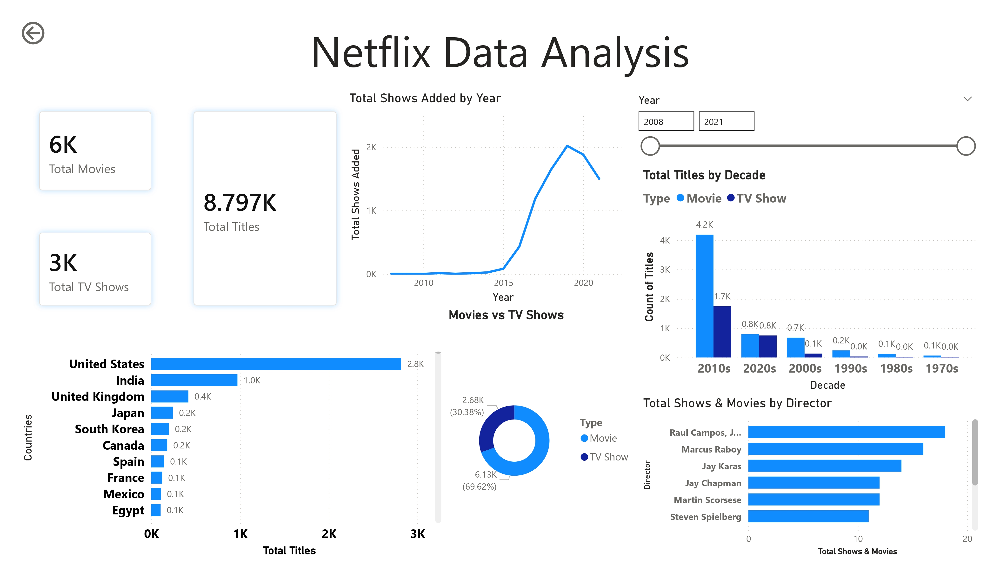

# Netflix Content Analysis — 8,800+ Titles Explored Using SQL and Power BI

Exploratory analysis of Netflix's content library using SQL and Power BI.
Analyzed 8,800+ titles to uncover trends in content type, country distribution,
genre popularity, and catalog growth over time.

---

## Dashboard



---

## Dataset

Source: [Netflix Movies and TV Shows — Kaggle](https://www.kaggle.com/datasets/shivamb/netflix-shows)

8,800+ titles with info on type, country, director, rating, duration, genres,
and when each title was added to Netflix.

---

## Tools

| Tool | Purpose |
|---|---|
| MySQL Workbench | Data cleaning and SQL analysis |
| Power BI Desktop | Dashboard and visualizations |

---

## Dashboard Overview

Single page dashboard covering:
- Total titles, movies, and TV shows KPI cards (8,797 total / 6K movies / 3K TV shows)
- Line chart showing catalog growth over the years
- Donut chart showing movies vs TV shows split
- Bar chart of top 10 countries by total titles
- Stacked bar chart of titles by decade split by type
- Top directors by total titles
- Year slicer to filter the full dashboard

---

## Key Findings

### 1. Movies dominate but TV shows are growing
69.62% of Netflix's catalog is movies (6,131 titles) vs 30.38% TV shows (2,676 titles).
However, TV show additions accelerated significantly post-2015, suggesting a strategic
shift toward episodic content to improve viewer retention.

### 2. US and India account for nearly half of all content
The US contributes 2,800 titles and India 1,000 — together nearly 44% of the entire
catalog. The UK is a distant third at 400 titles, showing how concentrated Netflix's
content sourcing is geographically.

### 3. Catalog growth peaked in 2019-2020 then slowed
Titles added per year grew rapidly from 2015 to 2019, then declined. The 2010s had
by far the most releases — 4,200 movies and 1,700 TV shows that decade. The slowdown
likely reflects COVID-19 production disruptions and Netflix's shift from volume to
quality in content acquisition.

---

## SQL Analysis

15 queries covering content breakdown, country analysis, director rankings,
growth trends, and decade-wise distribution.

Sample query:
```sql
-- movies vs tv shows split with percentage
SELECT type,
COUNT(*) AS total,
ROUND(COUNT(*) * 100.0 / SUM(COUNT(*)) OVER(), 2) AS percentage
FROM netflix
GROUP BY type
ORDER BY total DESC;
```

Full query file: [netflix.sql](netflix.sql)

---

## Files

```
├── netflix.sql              
├── netflix_data.csv         
├── netflix.pbix             
└── README.md
```

---

## How to Run

1. Import `netflix_data.csv` into MySQL using Table Data Import Wizard
2. Open `netflix.sql` in MySQL Workbench and run the queries
3. Open `netflix.pbix` in Power BI Desktop to view the dashboard

---

## Author

Purav Desai
B.Tech IT — Semester 6 | SCET, Surat

GitHub: [PuravDesai004](https://github.com/PuravDesai004)
LinkedIn: [your linkedin url here]
